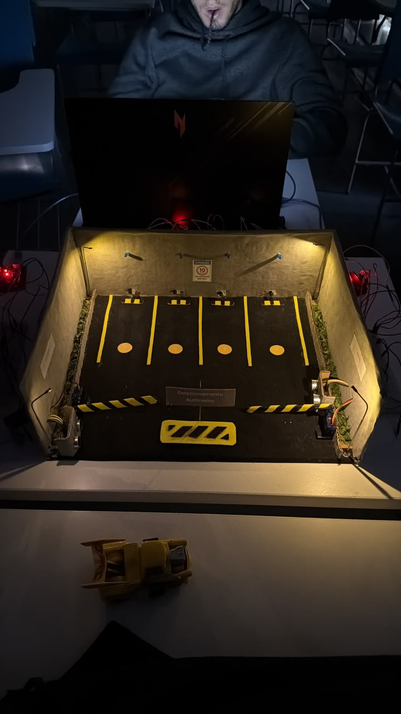

# Smart Parking IoT — Estacionamento Inteligente

Projeto acadêmico de Internet das Coisas (IoT) desenvolvido para demonstrar o controle de acesso e o monitoramento de um estacionamento em uma maquete.

## Sobre o projeto

O protótipo foi construído com duas placas Arduino Uno e um ESP32. As cancelas eram acionadas automaticamente ao detectar a aproximação de um veículo. A iluminação dos quatro postes era controlada por dois sensores LDR: quando escurecia, os postes acendiam. O ESP32 foi utilizado na parte de monitoramento das quatro vagas.

O relatório do projeto também descreve o envio de informações por MQTT e a visualização em aplicativo. As fotos e os vídeos registram a maquete construída pela equipe.

## Componentes e responsabilidades

| Componente | Papel no projeto |
| --- | --- |
| 2 Arduino Uno | Controle das cancelas e da iluminação (2 postes e 1 LDR por lado) |
| Sensores ultrassônicos HC-SR04 | Identificação da aproximação de veículos nas cancelas |
| 2 servomotores | Abertura e fechamento das cancelas |
| 2 LDRs | Detecção de baixa luminosidade, um em cada lado |
| 4 postes com LEDs | Iluminação automática conforme a luminosidade |
| ESP32 | Leitura do estado das quatro vagas e comunicação IoT |
| Sensores de vagas | Detecção de ocupação das quatro vagas (modelo exato não documentado) |
| Wi-Fi e MQTT | Comunicação para acompanhamento remoto, conforme relatório |

## Funcionamento

**Entrada e saída:** um sensor próximo à cancela detecta a aproximação e o servomotor aciona a barreira. O fechamento automático foi considerado na reconstrução do software.

**Iluminação:** cada Arduino lê um LDR e controla dois postes. Quando a luminosidade diminui além do limite ajustado, os postes ligam; quando clareia, desligam.

**Vagas:** o ESP32 lê quatro sensores de presença. A implementação proposta publica o estado de cada vaga por MQTT, para acompanhamento remoto.

## Código-fonte

- [`arduino/controle_lado/controle_lado.ino`](arduino/controle_lado/controle_lado.ino) — proposta de sketch para os dois Arduino Uno (ajustar o identificador de entrada/saída em cada placa).
- [`esp32/monitor_vagas/monitor_vagas.ino`](esp32/monitor_vagas/monitor_vagas.ino) — proposta de leitura de quatro vagas e publicação por MQTT.
- [`esp32/monitor_vagas/secrets.example.h`](esp32/monitor_vagas/secrets.example.h) — exemplo de configuração, sem credenciais verdadeiras.

### Observação sobre a versão do código

A maquete original foi desmontada e os arquivos-fonte do semestre foram perdidos. Por isso, **os sketches neste repositório são reconstruções propostas com base no relatório e nas lembranças da equipe**, e não cópias exatas dos arquivos originais. Foi preservado separadamente um backup compilado de um Arduino, mas ele não contém o código C++ editável.

**Os códigos atuais não foram validados na montagem física.** Num novo teste, será necessário confirmar pinos, modelo/polaridade dos sensores, alimentação dos servos, limites de movimento e parâmetros de rede antes de gravar as placas. Os pinos e tempos presentes nos sketches são exemplos configuráveis.

## Registros do protótipo

- [Relatório do projeto (PDF)](documentacao/relatorio.pdf)
- [Foto da maquete](imagens/maquete.jpeg)
- [Vídeo de demonstração 1](videos/demonstracao_1.mp4)
- [Vídeo de demonstração 2](videos/demonstracao_2.mp4)

## Tecnologias

Arduino IDE, C++, Arduino Uno, ESP32, Wi-Fi e MQTT. O relatório menciona o aplicativo MQTT Dash como interface de monitoramento.

## Como retomar o projeto

1. Abrir o arquivo `.ino` correspondente na Arduino IDE.
2. Conferir a pinagem real **antes** de gravar qualquer placa.
3. No ESP32, instalar a biblioteca `PubSubClient` e criar localmente um `secrets.h` usando `secrets.example.h` como modelo.
4. Ajustar sensor, LDR, ângulos dos servos e temporizadores durante testes em bancada.
5. Para um broker em nuvem com TLS, adaptar a conexão MQTT para usar certificado validado. O exemplo atual usa porta 1883 em rede local de testes.

> O código da cancela contém fechamento por tempo e não inclui uma barreira de segurança redundante. Não utilizar esse exemplo em cancelas reais sem proteções adequadas.

## Escopo

A documentação concentra-se no sistema embarcado e na maquete. A parte de banco de dados não foi incluída nesta versão do repositório.
